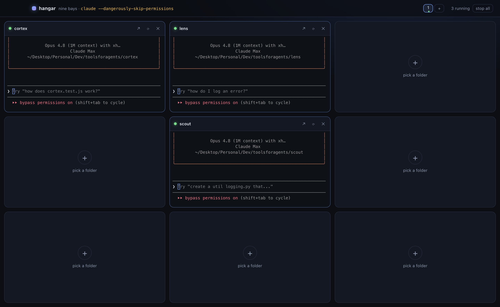

# hangar

**Nine bays. Press `+`, pick a folder, and a Claude agent starts there — live, in the tile.**

A small macOS desktop app for running several Claude Code agents at once and actually
watching them. Each bay is a real interactive terminal: you can read what the agent is
doing and type back into it. The folder's name becomes the bay's title. Nine to a page,
and you can add more pages.

<!-- screenshot: docs/hangar.png -->


---

## What a bay runs

```
claude --dangerously-skip-permissions
```

Exactly that, in the folder you picked, with your login shell's `PATH`.

**Read that flag before you use this.** It is Claude Code's own flag and it means the agent
never stops to ask: it edits files, runs commands, installs things and pushes, on its own.
That is the point of the app — nine unattended agents — and it is also nine blast radii. Point
a bay at a folder you would hand to an agent unsupervised, and not at your home directory.

The command is a constant in [`src/main.js`](src/main.js). The renderer cannot change it, and
nothing in the UI takes a command to run, so a bug in a tile cannot turn it into a shell.

## Auth and secrets

hangar has no accounts, no config, no API keys, and no network calls of its own. It spawns
your local `claude`, which authenticates itself exactly as it does in your terminal. Nothing
is sent anywhere, and there is nothing here to leak.

What it stores, in `~/Library/Application Support/hangar/state.json`: the folder paths you
picked and their titles. Nothing else.

## Install

Requires [Claude Code](https://claude.com/claude-code) on your `PATH` and Node 20+.

```sh
git clone https://github.com/tools-for-agents/hangar.git
cd hangar
npm install        # rebuilds node-pty against Electron — this is the slow step
npm start
```

To build a real `.app`:

```sh
npm run dist       # → dist/
```

## Using it

| | |
|---|---|
| `+` | pick a folder; the agent starts immediately |
| `⟳` | restart the agent in that bay |
| `✕` | stop the agent and empty the bay |
| `↗` | reveal the folder in Finder |
| `+` (top right) | add another page of nine |
| `stop all` | kill every running agent |

Click into a tile and type — it is a real terminal, so `shift+tab` cycles permission modes,
`esc` interrupts, and `/` commands work. Switching pages does not disturb an agent: the
process keeps running and the tile replays its output when you come back. Quitting hangar
stops every agent it started.

## Why it looks like this

hangar is part of [tools-for-agents](https://github.com/tools-for-agents) and uses the kit's
palette, 4px grid and type scale — the same design system [iris](https://github.com/tools-for-agents/iris)
gates the other tools against.

### Notes for anyone reading the source

Two things in here cost real time and are worth knowing:

- **A GUI app does not have your `PATH`.** Launched from Finder, the process inherits
  `/usr/bin:/bin:/usr/sbin:/sbin` — not your shell's `PATH` — so `~/.local/bin/claude` is not
  there and `spawn claude` fails on a machine where `claude` works fine. hangar asks your login
  shell where it is, once, and caches it.
- **A `display:` rule beats `[hidden]`.** `.plus` and `.live` both set `display`, so the
  `hidden` attribute did nothing until the stylesheet said `.plus[hidden] { display: none }`
  out loud. Every empty bay painted its status header and every running bay painted a `+` over
  its terminal. Only looking at a screenshot caught it.

## License

MIT
